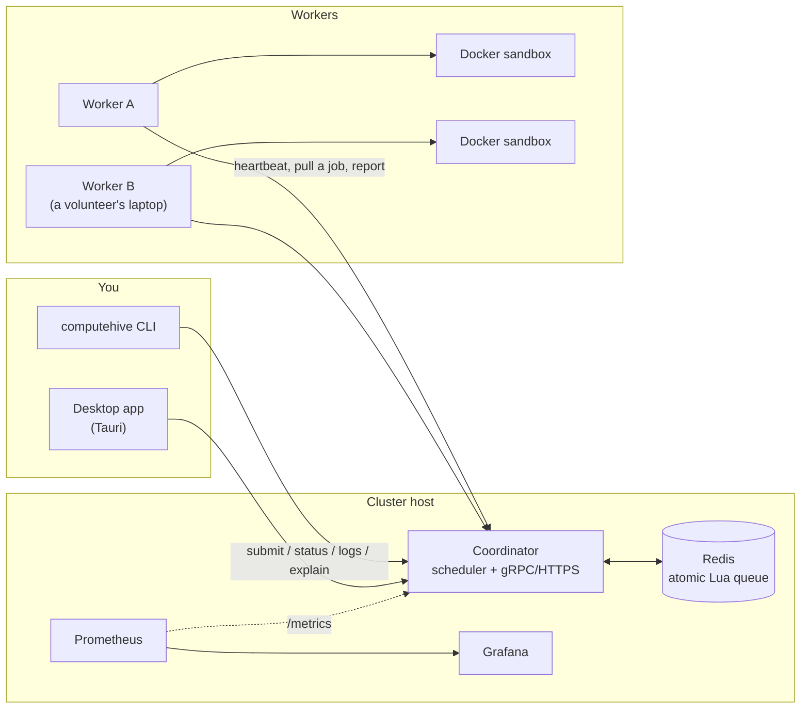

# ComputeHive

ComputeHive is a self-hosted distributed task runner. Give it a directory; it builds a container image, picks the best
available machine, runs the job in a locked-down sandbox, and hands you the result. Machines can be your own servers or
volunteers' laptops, and the system is built so that **a worker dying never loses a job**, **a job never runs its result
twice**, and **a contributor's machine is never pushed past 90% of its RAM, CPU or disk**.

```bash
make up                                  # coordinator + Redis + 3 workers + Prometheus + Grafana, TLS and auth on
./bin/computehive submit examples/hello --wait
```

> **Status.** Everything described here is implemented and has a test or a reproducible script behind it; what is *not*
> verified is listed plainly under [Known limitations](#known-limitations). The history of what was wrong and what changed
> is in [docs/AUDIT.md](docs/AUDIT.md), and the reasoning behind each choice in [docs/decisions.md](docs/decisions.md).

## What it guarantees, and how that is tested

| Guarantee | Mechanism | Evidence |
|---|---|---|
| A job is assigned to exactly one worker | one atomic Lua script moves it from pending to leased | `TestConcurrentClaimNeverDoubleAssigns` |
| FIFO order, preserved on retry | pending set scored by the job's original sequence | `TestRequeueKeepsFIFOPositionAndCountsAttempt` |
| A dead worker's jobs are requeued in under 15 s | 2 s heartbeats, dead after 6 s, reaper every 1 s | `TestWorkerKilledMidJobIsRequeuedUnder15s...`, `scripts/chaos-cluster.sh` |
| A late result from a presumed-dead worker cannot corrupt anything | per-attempt lease tokens; stale and duplicate results are discarded | `TestPartitionedWorkerNeverCommitsOverRequeuedJob` |
| No job lost, none committed twice | all state in Redis (AOF), a stateless coordinator, a server-side `commits` audit counter | `TestThousandJobsWithRandomWorkerKills`, `TestCoordinatorCrashAndRestartLosesNothing`, `TestRedisRestartKeepsState` |
| A worker never takes work above 90% RAM/CPU/disk | enforced on the worker **and** independently in the coordinator | `make pressure`, `TestWorkerStopsRequestingJobsAtThresholdAndResumesAfterHysteresis` |
| Hostile jobs are contained | non-root, no capabilities, read-only rootfs, limits, argument audit | `make hostile`, `examples/hostile` |

"Exactly once" means **committed** exactly once: a worker killed mid-job means the job body may run again elsewhere, so jobs
should be idempotent or write only to their output directory. Run the fault-injection suite yourself with `make chaos`.

## Architecture at a glance



Workers *pull* work over an outbound connection, so a laptop behind NAT can contribute. Every state change is one atomic Redis
script. The full design (components, job lifecycle, Redis data model, failure detection, security) is in
[docs/ARCHITECTURE.md](docs/ARCHITECTURE.md).

## Quickstart

Prerequisites: Docker with Compose v2, Go 1.25+, `make`.

```bash
git clone <this repo> && cd ComputeHive
make up      # builds the images on the first run, generates TLS certificates and tokens in .computehive/
make demo    # a guided real run: jobs, live output, kill a worker mid-job, watch the cluster recover (~80 s)
```

The first run is dominated by Docker image builds; later runs take seconds.

`make demo` prints what it measured, for example: six jobs spread two per worker; live output streamed while a job runs; and,
after a `kill -9` of the worker running a 30 s job, the job re-assigned to another worker and finished on attempt 2 of 3.

Then explore:

```bash
./bin/computehive workers                          # workers, state, RAM/CPU/disk, reliability
./bin/computehive submit examples/hello --wait     # your own job: any directory with a Dockerfile
./bin/computehive jobs                             # recent jobs, newest first
./bin/computehive logs <job-id> --follow           # watch a running job's output
./bin/computehive explain <job-id>                 # why it went to that worker (scores per worker)
make down                                          # stop (data volumes are kept)
```

| Endpoint | URL |
|---|---|
| Coordinator gRPC | `localhost:50051` (TLS, API token) |
| Coordinator HTTPS (artifacts, `/healthz`, `/readyz`, `/metrics`) | `https://localhost:8080` |
| Grafana, with a provisioned cluster dashboard (admin / admin) | http://localhost:3000 |
| Prometheus | http://localhost:9090 |

The CLI finds the API token and CA in `.computehive/` automatically. Redis is published on an ephemeral loopback port
(`docker compose port redis 6379`) so it never clashes with one you already run.

## Running your own jobs

`computehive submit <dir>` builds the directory's Dockerfile, saves the image, uploads it (addressed by its SHA-256), and submits
the job. Requirements can come from flags, from `computehive.yaml` in the directory (flat `key: value`), or from
`LABEL computehive.<key>=...` lines in the Dockerfile; flags win.

```bash
computehive submit examples/hello --cpu 2 --mem 1024 --timeout 600 --wait
computehive submit myjob --os linux --arch amd64 --label fast-disk --min-disk 5000
computehive submit myjob --verify                       # run on two different workers; accept only if the outputs match
computehive submit myjob --network-host pypi.org        # only workers whose owner allows it will run it
computehive result <job-id> --download ./results        # output files, each verified against its SHA-256
```

`--wait` makes the exit code meaningful (non-zero unless the job succeeded), so `submit --wait && next-step` works. An unchanged
directory is not rebuilt, so repeat submissions reuse the same artifact and prefer a worker that already holds it (`--rebuild` to
force). Details: [docs/SCHEDULING.md](docs/SCHEDULING.md).

### Examples

| Example | Shows |
|---|---|
| `examples/hello` | the minimal job |
| `examples/sleep` | a long job to watch, or to kill a worker under (`SLEEP_SECONDS`) |
| `examples/deterministic` | a job whose output is identical everywhere, for `--verify` |
| `examples/cpu-heavy` | two CPUs burned for 15 s, capped at the requested 2 |
| `examples/memory-heavy` | fits its limit; with `--mem 128 --env ALLOCATE_MB=600` the kernel OOM-kills it (exit 137) and the host is untouched |
| `examples/failing` | exits 3: a job's own failure is terminal and is not retried |
| `examples/hostile` | tries ten attacks from inside the sandbox and reports whether each was blocked |

## Desktop app

A Tauri app with three tabs: **Run** (pick a folder, set resources, run, follow live output, see why a worker was chosen, download
verified results), **Cluster** (live view of workers with their RAM/CPU/disk against the 90% limit, and recent jobs) and
**Contributor** (share this machine: start/stop, pause, CPU/RAM/disk limits, idle-only, schedule, network allow-list). It talks to the
same secured API as the CLI.

```bash
make up                                # the app reads .computehive/ for the token and CA
cd client && npm install && npm run tauri dev
```

The window scrolls and reflows from phone width up (audited at 340 to 1920 px). Rust unit tests: `cd client/src-tauri && cargo test`;
tests against a running cluster: `cargo test -- --ignored --test-threads=1`. The GUI itself is not exercised headlessly in CI.
See [client/README.md](client/README.md).

## Adding machines

On the coordinator, mint a single-use token. It prints a complete command, including the CA's SHA-256 fingerprint:

```bash
./bin/computehive admin enroll --ttl 1h
```

On the new machine (needs Docker):

```bash
git clone <this repo> && cd ComputeHive
scripts/join.sh --coordinator <host>:50051 --token chet_... --ca-sha256 <fingerprint>
```

The script downloads the cluster CA from the coordinator and **refuses to continue unless its fingerprint matches**, so a man in the
middle cannot substitute their own. The worker then enrols once and keeps its own revocable credential. Revoke a worker with
`computehive admin revoke <worker-id>`.

### Contributor controls

The person who owns the machine decides what runs on it. These talk to the worker over a private Unix socket (mode 0600):

```bash
computehive worker status                                  # state, why it is not taking jobs, resources, policy
computehive worker pause [--now]                           # stop taking jobs (--now also hands back the running job)
computehive worker resume
computehive worker kill                                    # kill switch: stop everything immediately and exit
computehive worker history                                 # exactly what ran here (image, command, env NAMES, outcome)
computehive worker policy set max_cpus=2 max_memory_mb=4096 schedule=22:00-07:00 idle_only=true
computehive worker policy set allow_network=true allowed_hosts=pypi.org     # off by default
```

The policy is enforced on the worker itself, so the cluster cannot override it. Ctrl-C or SIGTERM *drains*: the worker finishes its
current job (up to `DRAIN_TIMEOUT`, 30 s) and exits; a second signal stops it at once.

## How a job picks its worker

A worker is handed a job only if it is the best idle fit for it, or the job has waited past a patience window (so nothing starves).
The coordinator first rejects workers that are stale, overloaded, lack the CPU/RAM/GPU/disk/OS/arch/labels/isolation/network permission,
have no memory headroom, are unreliable, or whose user is at their limit; then it ranks the rest by free RAM, free CPU, load,
reliability, artifact locality, fit, uptime and the contributor's preference. The atomic Lua claim re-checks every safety rule, so the
scheduler can only improve a placement, never break a rule. `computehive explain <job-id>` shows every worker's verdict and score.
Full description and limits: [docs/SCHEDULING.md](docs/SCHEDULING.md).

## Resource safety (the 90% rule)

Workers sample RAM, CPU, load, disk (work directory and Docker root), swap, temperature, Docker health, GPU and network egress every second.

- **Enter** "overloaded" the moment RAM, CPU or disk reaches **90%** (`RAM_LIMIT_PERCENT`, `CPU_LIMIT_PERCENT`, `DISK_LIMIT_PERCENT`).
- **Leave** only after every metric has stayed below **80%** for **10 s**; readings in between change nothing (no flapping).
- **Enforced twice:** the worker stops asking for jobs; independently the coordinator derives overload from the numbers and refuses
  overloaded, stale or metric-less workers, so a misbehaving worker cannot opt out.
- **Headroom:** a job is not placed if its declared memory (default 512 MB) would push the host over the limit.
- **If the host stays critical for 15 s while a job runs**, the job is stopped gracefully and requeued elsewhere without counting as a failure.
- **Every job container** gets `--memory` = `--memory-swap` (no swap), `--cpus`, `--pids-limit` and `--network none`, with defaults if it declares nothing.

Prove it: `make pressure`, and `cd worker && go test ./internal/monitor/ -run RealContainer -v`.

## Security model (summary)

Jobs are treated as untrusted and possibly malicious. The full model, with the test behind each mitigation and the residual risks, is in
[docs/THREAT_MODEL.md](docs/THREAT_MODEL.md).

- **Sandbox per job:** non-root, all capabilities dropped, `no-new-privileges`, read-only root filesystem, default seccomp, no network,
  no Docker socket, only its own work directory, memory/swap/CPU/PID/file limits, wall-clock timeout with forced kill, disk quota, capped logs.
  A final audit refuses to start any container whose flags weaken this.
- **No surprises on your Docker:** images are never pulled, registry logins never used, an uploaded image may not retag your images, and
  everything a job created is removed afterwards.
- **Optional network:** only when the job asks and your policy allows the host, through a filtering proxy that refuses private, loopback
  and cloud-metadata addresses.
- **Trust:** TLS 1.3 (mTLS optional), expiring single-use enrollment tokens, hashed revocable per-worker credentials, an API token for
  submitters, per-source and per-identity rate limits, validated inputs. The coordinator **refuses to start** without a token and TLS unless
  you pass `AUTH_DISABLED` / `ALLOW_INSECURE`, which log loudly.
- **Untrusted output:** job output is stripped of terminal control sequences before it reaches your terminal, and is only ever shown
  as text in the app.
- **Result integrity:** `--verify` runs the job on two workers and accepts it only if the outputs match: 2x cost, deterministic jobs only,
  and it detects disagreement without knowing who lied.
- **gVisor** is supported when available ([docs/GVISOR.md](docs/GVISOR.md)); it is implemented but not verified here.

## Observability

`make up` starts Prometheus and Grafana. The coordinator exposes an authenticated `/metrics`; 12 alert rules cover a down coordinator or Redis,
lost workers, the 90% rule, a stuck queue and a growing dead-letter set; Grafana opens with a provisioned **ComputeHive cluster**
dashboard (a live one-row-per-worker view, latency histograms, failures, RPCs). Logs are JSON with request and job ids. The coordinator and
workers shut down gracefully. Details, the metric catalogue and a runbook: [docs/OPERATIONS.md](docs/OPERATIONS.md).

## Make targets

| Target | What it does |
|---|---|
| `make up` / `make down` / `make logs` | run the local cluster (3 workers) |
| `make demo` | guided real run: jobs, live output, kill a worker, recovery |
| `make test` | unit tests with the race detector, all Go modules |
| `make lint` | `go vet` + `staticcheck`, all modules |
| `make build` | `bin/computehive`, `bin/computehive-worker`, `bin/computehive-coordinator` |
| `make proto` | regenerate protobuf Go code (needs `protoc-gen-go` and `protoc-gen-go-grpc` on `PATH`) |
| `make chaos` | fault injection: in-process suite plus `docker kill` of real workers |
| `make pressure` | overloaded-worker check on the running cluster |
| `make hostile` | hostile-job suite: every attack contained, the host stays healthy |
| `make enroll` | print a one-hour, single-use token for joining a worker |
| `make reset` | stop the cluster and delete all its data and secrets |
| `make bench` | reproducible benchmarks; results and honest limits in [docs/BENCHMARKS.md](docs/BENCHMARKS.md) (`SECTION=control\|reliability\|safety\|cluster`, `BENCH_QUICK=1`) |

## Configuration

Coordinator (flags override env): `REDIS_ADDR`, `REDIS_PASSWORD`, `REDIS_TLS`, `GRPC_PORT` (50051), `HTTP_PORT` (8080), `API_TOKEN` /
`API_TOKEN_FILE`, `TLS_CERT_FILE`, `TLS_KEY_FILE`, `WORKER_DEAD_AFTER` (6s), `MAX_ATTEMPTS` (3), `RAM_LIMIT_PERCENT` (90), `USER_LIMIT`
(0 = off), `SCHED_PATIENCE` (5s), `SHUTDOWN_GRACE` (3s). Invalid values fail at startup with a message naming the flag and env var.

Worker: `COORDINATOR_ADDR`, `COORDINATOR_TLS_CA`, `ENROLLMENT_TOKEN`, `WORKER_ID`, `WORKER_LABELS`, `WORKER_PREFERENCE`, `ARTIFACT_CACHE_MB` (2048),
`DRAIN_TIMEOUT` (30s), `LOG_FORMAT` (json), `ISOLATION` (auto|runc|gvisor). See [worker/README.md](worker/README.md).

CLI: `--coordinator`, `--token`, `--ca` (or `COMPUTEHIVE_COORDINATOR`, `COMPUTEHIVE_TOKEN`, `COMPUTEHIVE_CA`, or the files in `.computehive/`).

## Troubleshooting

| Symptom | Likely cause and fix |
|---|---|
| `make up` fails immediately | Docker is not running, or your user cannot use it. Check `docker info`. |
| `unauthenticated` from the CLI or app | The API token was not found. It is `.computehive/api.token` (written by `make up`); pass `--token` or set `COMPUTEHIVE_TOKEN`. |
| A job stays `queued` | No worker satisfies its requirements. `computehive explain <job-id>` lists each worker's reason (GPU, `--os`, `--label`, memory headroom, ...). |
| A worker shows `overloaded` | The host is at 90% RAM/CPU/disk (the reason is shown). It recovers 10 s after every metric is under 80%. |
| Workers report `docker_unhealthy` after running `docker compose` by hand | Compose needs the Docker group id. Use `make` targets or `source scripts/env.sh` first. |
| Prometheus target is down | Prometheus needs the API token and CA from `.computehive/` (mounted by `docker-compose.yml`); check `docker compose logs prometheus`. |
| `REFUSING TO TRUST the CA` on join | The fingerprint you were given does not match what the coordinator serves: a typo, a regenerated CA, or something answering in its place. Get the command again from `admin enroll`. |
| Grafana will not start after upgrading | Rarely, an old datasource conflicts. `docker compose rm -sf grafana && make up`. |
| The desktop app says "No API token found" | Run `make up` from the repository (the app looks for `.computehive/`), or set `COMPUTEHIVE_TOKEN`. |
| `make proto` says `protoc-gen-go: program not found` | Add Go's bin directory to `PATH`: `PATH=$PATH:$(go env GOPATH)/bin make proto`. |

## Repository layout

```text
ComputeHive/
├── cli/             # `computehive` CLI (Go)
├── client/          # Tauri desktop app (TypeScript + Rust)
├── coordinator/     # scheduler, queue (Lua), gRPC + HTTPS API, metrics (Go)
├── worker/          # worker runtime: monitor, sandbox, network proxy, artifact cache (Go)
├── shared/proto/    # protobuf contracts (source of truth; changes are additive)
├── deploy/          # Prometheus rules and scrape config, Grafana provisioning and dashboard
├── examples/        # example jobs
├── scripts/         # bootstrap, demo, join, chaos and pressure scripts
├── docs/            # architecture, scheduling, operations, threat model, decisions, audit
├── docker-compose.yml
└── Makefile
```

| Document | What it covers |
|---|---|
| [docs/ARCHITECTURE.md](docs/ARCHITECTURE.md) | components, job lifecycle, Redis data model, atomicity, failure recovery, interfaces |
| [docs/BENCHMARKS.md](docs/BENCHMARKS.md) | every measured number, the exact command behind it, the machine and its load, and what was not measured |
| [docs/SCHEDULING.md](docs/SCHEDULING.md) | filters, scoring, patience, locality, `explain` |
| [docs/OPERATIONS.md](docs/OPERATIONS.md) | metrics, alerts, logs and correlation ids, graceful shutdown, runbook |
| [docs/THREAT_MODEL.md](docs/THREAT_MODEL.md) | assets, attackers, mitigations with their tests, residual risks |
| [docs/decisions.md](docs/decisions.md) | every important decision: options, choice, tradeoff, evidence |
| [docs/AUDIT.md](docs/AUDIT.md) | what was wrong at the start and what changed |
| [docs/GVISOR.md](docs/GVISOR.md) | optional gVisor isolation |

## Known limitations

- **Not verified here:** gVisor isolation (no `runsc` available); GitHub Actions (the workflow was never run); macOS and Windows; the desktop
  app's native window was not driven by an automated GUI test (the backend is tested against a live cluster and the UI against a browser).
- Job output files are kept on the coordinator until you delete them (no retention policy yet).
- Network-allowlist mode needs the worker to run directly on the host, not in a container.
- Containers share the host kernel (unless gVisor is used): a kernel vulnerability is the main residual risk.
- One coordinator and one single-node Redis: no automatic failover (the Lua scripts address keys dynamically, so Redis Cluster would need hash tags).
- Scheduling weights are hand-set, not tuned, and a worker with a longer track record tends to keep winning ties ([docs/SCHEDULING.md](docs/SCHEDULING.md)).
- Re-submitting an unchanged directory reuses the saved image; a changed base image is not noticed until `--rebuild`.
- Prometheus data is not persisted across container restarts in Compose, and alerts are not delivered anywhere (no Alertmanager).
- Sandbox kills are counted by exit code 137/143, which also includes a manual kill, so that metric is an approximation.
- Live output lags by about two seconds (it rides on the heartbeat) and shows only the last few KB.
