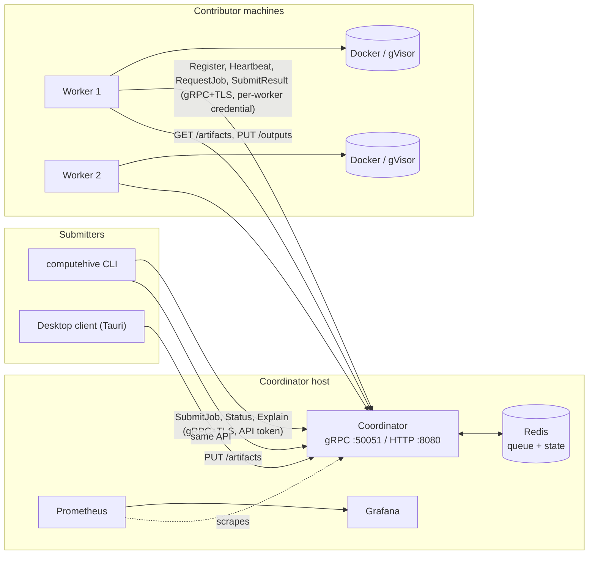
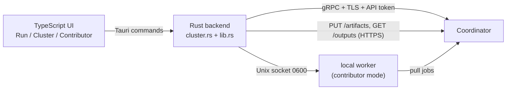
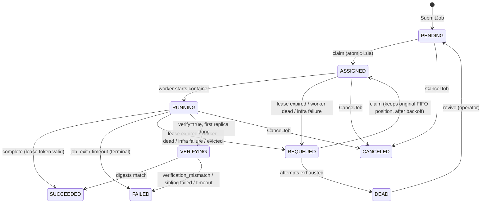
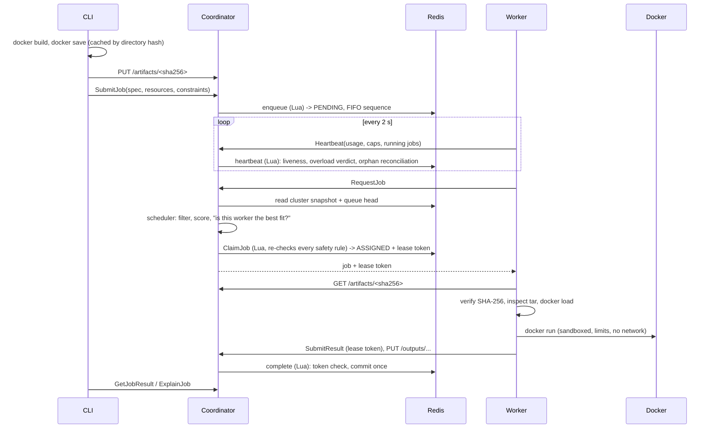
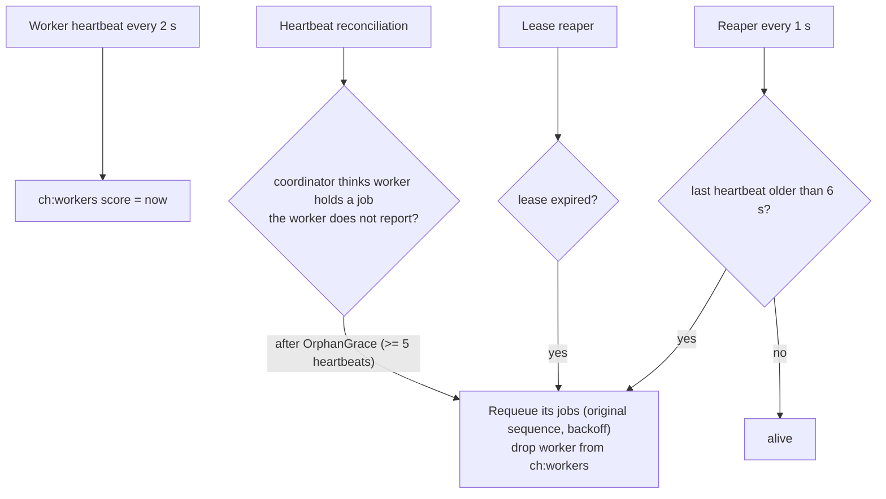
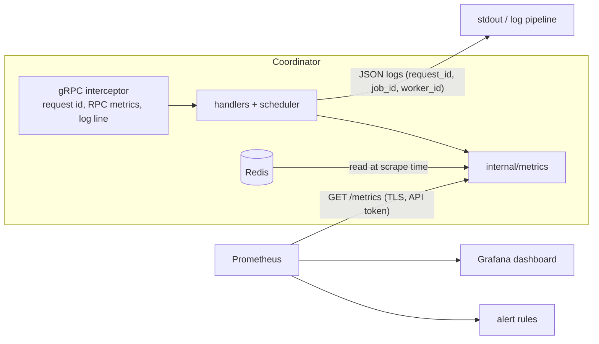

# ComputeHive architecture and system design

This is the map of the whole system: what the pieces are, how a job moves through them, where state lives, what is
atomic, how failure is detected and what happens next, and which guarantees are tested. Deeper dives:
[SCHEDULING.md](SCHEDULING.md) (placement), [THREAT_MODEL.md](THREAT_MODEL.md) (security), [GVISOR.md](GVISOR.md),
[decisions.md](decisions.md) (why each choice was made), [AUDIT.md](AUDIT.md) (what was wrong at the start and what changed).

Everything here describes behaviour that exists in the repository and is covered by a test or a reproducible script. Anything
that is not verified is called out in [section 15](#15-what-is-not-verified-or-not-built).

## 1. Goals and non-goals

**Goals**
- Run a containerised job on somebody's machine and get its result back, reliably, from one command.
- Never lose a job when a single worker dies; never run one job's result twice ("exactly-once commit").
- Never take a contributor's machine past a safe resource ceiling (the 90% rule).
- Treat the job as hostile code and the contributor's machine as precious (sandboxing, trust, policy).
- Be explainable: for any job, say which worker was chosen and why.

**Non-goals (today)**
- Confidentiality of submitted code from the worker's owner (the owner can read whatever runs on their machine).
- Multi-region or multi-coordinator high availability: there is one coordinator and one Redis.
- A general workflow engine: jobs are independent, single-container runs.

## 2. System context

The coordinator is the only component that talks to Redis. Workers and submitters never see it. Workers *pull* work
(`RequestJob`), so a worker behind NAT needs only an outbound connection.

## 3. Components

### Coordinator (`coordinator/`, Go)

| Package | Responsibility |
|---|---|
| `internal/queue` | The heart: every state transition is one atomic Lua script against Redis (`scripts.go`); the Go wrapper (`queue.go`) plus read-only cluster snapshots for the scheduler (`snapshot.go`). Background reapers (dead workers, expired leases, verification timeouts). |
| `internal/scheduler` | Pure placement logic: hard filters, weighted score, patience override, explanation. No I/O. |
| `internal/grpc` | `WorkerService`, `ClientService`, `AdminService`. Input validation (`validate.go`), the scheduler glue and `ExplainJob` (`schedule.go`), enrollment and revocation (`admin.go`). |
| `internal/auth` | Enrollment tokens, per-worker credentials (hashed), API token, rate limits, TLS/mTLS certificate generation. |
| `internal/httpapi` | Content-addressed artifact store (`/artifacts/<sha256>`), per-attempt output store (`/outputs/...`), `/healthz`, `/readyz`. |
| `internal/metrics` | Prometheus series: cluster gauges read from Redis at scrape time, event counters and histograms recorded inline. See [OPERATIONS.md](OPERATIONS.md). |
| `internal/config` | Flags and environment; refuses insecure defaults. |
| `internal/chaos`, `internal/testutil` | The fault-injection harness and a real-Redis-in-Docker test helper. |

### Worker (`worker/`, Go)

| Package | Responsibility |
|---|---|
| `internal/worker` | The agent loop: register, heartbeat every 2 s, admission gate, pull a job, run it, report. Pressure loop that evicts jobs if the host becomes overloaded. Contributor controls. |
| `internal/monitor` | Resource sampling (RAM, CPU, load, disks, Docker health, GPU) and the hysteresis state machine behind "overloaded". |
| `internal/executor` | Builds and audits the `docker run` command line, applies the sandbox, enforces limits and quotas, removes containers deterministically. |
| `internal/netproxy` | The per-job network-allowlist proxy sidecar. |
| `internal/artifact` | Fetch, SHA-256-verify and cache (LRU) job artifacts; inspect image tarballs before `docker load`. |
| `internal/store` | gRPC client to the coordinator: TLS, credential persistence, enrollment. |
| `internal/policy`, `internal/control`, `internal/history` | The contributor's local policy file, the Unix control socket, and the history log. |
| `internal/output` | Collects job output files and uploads them to the coordinator (or S3/R2). |

### CLI (`cli/`, Go) and desktop client (`client/`, Rust/Tauri)

The CLI builds the job directory into an image, saves it, uploads the tarball (by hash), submits the job and reads results. It
also controls the local worker (`worker pause|resume|kill|policy|history`) and the cluster (`admin enroll|revoke`, `workers`,
`explain`). The desktop client offers the same flow in a UI.

### Desktop app (`client/`, Tauri: Rust backend + TypeScript frontend)

Three tabs over the same secured API as the CLI: **Run** (build, upload, submit, follow live output, see why a worker was chosen, download verified results),
**Cluster** (workers against the 90% limit, recent jobs) and **Contributor** (start/stop a local worker, pause, donation limits). The Rust backend (`cluster.rs`) does config
discovery, the TLS+token gRPC channel, artifact upload to the coordinator's store, SHA-256-verified output download, and an HTTP client for the local worker's private control
socket. It never touches Redis or an object store. See [client/README.md](../client/README.md).

### Shared (`shared/proto/`)

Three proto files (`worker`, `client`, `admin`). Rule: **additive changes only** (new fields and RPCs, never renumbering or removal),
so an older worker keeps working against a newer coordinator.

## 4. Job lifecycle

Failure reasons decide what happens next:

| Reason | Meaning | Result |
|---|---|---|
| `job_exit`, `timeout` | The job itself failed or ran too long | Terminal `FAILED` (retrying would just repeat it) |
| `infra` | Worker/Docker problem (image load failed, daemon down) | Retried on another worker, counts against `max_attempts` |
| `evicted` | The host became overloaded and the job was stopped to protect it | Retried, does **not** burn an attempt |

A requeued job keeps its original sequence number, so it is not sent to the back of the line.

## 5. End-to-end flow

## 6. State in Redis

All keys are prefixed `ch:`. Time always comes from Redis `TIME`, never from a worker's clock.

| Key | Type | Content |
|---|---|---|
| `ch:seq` | counter | FIFO sequence generator |
| `ch:pending` | ZSET | job ids scored by sequence (the queue) |
| `ch:job:<id>` | hash | state, attempt, lease token, worker, `last_worker`, spec JSON, requirements, timestamps, `commits`, placement `decision` |
| `ch:jobs` | set | all job ids |
| `ch:leases` | ZSET | job id scored by lease expiry |
| `ch:result:<id>` | string | the committed result (written once) |
| `ch:dead` | set | jobs parked after exhausting attempts |
| `ch:counts` | hash | jobs per state |
| `ch:workers` | ZSET | worker id scored by last heartbeat (ms) |
| `ch:worker:<id>` | hash | capacity, platform, labels, usage, overload flag and reasons, isolation |
| `ch:wrun:<id>` | set | jobs the coordinator believes the worker holds |
| `ch:wcache:<id>` | set | artifact digests the worker holds (for locality) |
| `ch:wstat:<id>` | hash | decayed success/failure counts (reliability) |
| `ch:urun:<user>` | counter | running jobs per user (per-user limit) |
| `ch:verifying` | ZSET | replicas waiting for their sibling |
| `ch:jtail:<id>` | string | the last 4 KB of a running job's output (live logs), expires after 24 h |
| `ch:enroll:<sha256>`, `ch:cred:<id>`, `ch:revoked` | | enrollment tokens, hashed worker credentials, revocations |

Redis runs with AOF persistence, so a Redis crash loses at most the last fsync interval of writes (tested with SIGKILL).

## 7. Atomicity, leases and exactly-once

- **Every transition is one Lua script**, which Redis runs without interleaving. `claim` removes the job from `ch:pending`, sets
  `ASSIGNED`, records the lease and adds it to the worker's set in a single step, so two workers cannot be given the same job
  (tested: 3000 jobs, 48 concurrent claimers, zero double-assignments).
- **Lease tokens fence stale actors.** A claim mints a token. `complete`, `fail` and `markRunning` must present the current token;
  a result from a superseded attempt is answered `STALE`, a repeat `DUP`, and neither changes anything.
- **`commits` counter.** `complete` increments an audit counter on the job. The chaos suite asserts it ends at exactly 1 for every
  job, which is the "no job lost, none run twice" claim in a form a test can check.
- **The Lua claim is the safety net, the scheduler is an optimisation.** The scheduler reads a (possibly slightly stale) snapshot
  and decides who *should* get a job; the claim script re-checks capacity, overload, requirements, isolation, memory headroom and
  the per-user limit atomically before assigning. A stale snapshot can make a placement worse, never unsafe.

## 8. Failure detection and recovery

Measured time from `kill -9` of a worker to the job being requeued: 5.6–6.7 s in-process and 4.7–5.9 s on real containers
(the 6 s dead-after threshold is the floor). The orphan reconciliation exists because a lost claim *reply* otherwise strands a job
on a live worker; it was found by a flaky chaos test and is covered by a regression test.

## 9. Scheduling

See [SCHEDULING.md](SCHEDULING.md). In short: hard filters (alive, not overloaded, requirements met, memory headroom, not
blacklisted, user limit) then a transparent weighted score (free RAM, free CPU, load, reliability, locality, uptime, preference,
fit). A worker is handed a job only if it is the best idle fit, or the job has waited past a patience window. `computehive explain`
shows the decision.

## 10. Resource safety (the 90% rule)

- The worker samples RAM, CPU, disks and Docker health continuously. A metric at or above its limit (default 90%) puts the worker
  in `overloaded`; it recovers only after **every** metric stays one band below its own limit for 10 s (hysteresis, so it cannot flap).
- The rule is enforced **twice**: the worker refuses new work, and the coordinator derives overload from the raw metrics itself and
  refuses to assign (a worker's say-so is not trusted). A worker that sends no metrics gets no work.
- **Memory headroom projection:** a job is only placed if current use plus memory already promised to running jobs plus the new
  job's request stays under the limit, so two jobs cannot both be placed on the strength of one stale reading.
- **Pressure eviction:** if the host goes over the limit while jobs run, after a short grace period the newest job is stopped and
  requeued as `evicted` (no attempt burned).
- **Hard container limits** on every job: memory (no swap), CPU, PIDs, file size and descriptors.

Tested on a real container: pushing a host from 69% to 76.8% RAM against a 73% limit tripped the rule and it resumed 2 s after the
pressure was removed.

## 11. Sandbox and trust

Detailed in [THREAT_MODEL.md](THREAT_MODEL.md). Summary:

- **Container:** non-root, all capabilities dropped, `no-new-privileges`, read-only root filesystem, `noexec` scratch tmpfs,
  default seccomp, no network by default, the Docker socket never mounted. A final audit of the `docker run` arguments refuses to start a container
  carrying any dangerous flag. Optional gVisor (`runsc`) is auto-detected (**implemented but not verified here**).
- **Network allowlist:** a job that needs the network joins a private `--internal` Docker network whose only peer is a locked-down
  proxy sidecar; the proxy resolves DNS itself, blocks private/loopback/metadata ranges after resolution, and allows only listed hosts on 80/443.
- **Contributor policy:** the contributor, not the cluster, has the last word (CPU/RAM caps, schedule, idle-only, network on/off,
  image allow/deny, pause, kill switch), enforced locally.
- **Transport and identity:** TLS 1.3, optional mTLS; expiring limited-use enrollment tokens that mint a per-worker credential
  (stored hashed, revocable); an API token for submitters; per-source and per-identity rate limits applied before authentication.
- **Result integrity:** optional redundant execution (`--verify`) compares output digests from two different workers.
- **Untrusted output:** job output is stripped of terminal control sequences before reaching a terminal, and shown only as text in the app.
- **Joining:** a new worker fetches the cluster CA and trusts it only if its SHA-256 matches a fingerprint given out of band.

## 12. Artifacts and outputs

- Job images travel as `docker save` tarballs addressed by SHA-256. The CLI caches the saved tarball by a hash of the job directory,
  so an unchanged directory is byte-identical across submits (Docker stamps build time into images, so rebuilding is not).
- Workers verify the digest, inspect the tar's manifest *before* `docker load` (every tag must be in the `computehive-job:` namespace,
  so a crafted image cannot overwrite the contributor's `ubuntu:latest`), then keep verified artifacts in a size-bounded LRU cache
  and advertise them for locality scoring. Cache entries are re-hashed on every read.
- Output files are uploaded to the coordinator by the current lease holder only (re-checked after the upload), SHA-256 verified,
  stored per attempt, and fetched with `result --download` (hash re-verified, hostile paths rejected).

## 13. Interfaces

| Interface | Used by | Auth |
|---|---|---|
| gRPC `WorkerService`: `RegisterWorker`, `Heartbeat`, `RequestJob`, `SubmitResult` | workers | per-worker credential (enrollment token on first call) |
| gRPC `ClientService`: `SubmitJob`, `GetJobStatus` (with live output), `GetJobResult`, `CancelJob`, `ListWorkers`, `ListJobs`, `ExplainJob` | CLI, desktop client | API token |
| gRPC `AdminService`: `CreateEnrollmentToken`, `RevokeWorker` | operator | API token |
| HTTP `PUT/GET /artifacts/<sha256>` | CLI (write), workers (read) | API token / worker credential |
| HTTP `PUT/GET /outputs/<job>/<attempt>/<path>` | workers (write, lease holder only), CLI (read) | worker credential / API token |
| HTTP `/healthz`, `/readyz` | orchestrators, probes | none (`/readyz` is 503 while draining) |
| HTTP `GET /ca.crt` | a new worker joining (checked against a fingerprint it was given) | none; public material, rate-limited |
| HTTP `GET /metrics` | Prometheus | API token |
| Worker Unix socket (0600) | the contributor's CLI | file permissions |

## 14. Observability and shutdown

- **Metrics, alerts, dashboard, logs, runbook:** see [OPERATIONS.md](OPERATIONS.md). Prometheus scrapes the coordinator's authenticated `/metrics` over TLS;
  12 alert rules cover availability, workers, the 90% rule, a stuck queue, the dead-letter set and scheduling latency; a provisioned Grafana dashboard
  doubles as the live cluster view.
- **Correlation:** every gRPC call gets a request id (echoed in the `x-request-id` response header) and a structured log line carrying `job_id` and `worker_id`.
- **Graceful shutdown:** the coordinator reports not-ready for a grace period while still serving, then drains in-flight calls. A worker stops taking jobs, tells the coordinator it
  is draining, lets the current job finish for up to `DRAIN_TIMEOUT`, then hands it back (as `evicted`, no attempt burned). A second signal or the kill switch stops immediately.

## 15. What is not verified or not built

Stated plainly, so nothing here is read as a claim:

- **gVisor** isolation is implemented but was never run (no `runsc` in the development environment).
- **GitHub Actions** CI is written but has never executed.
- The **Tauri desktop client** was not tested headless; macOS and Windows were not tested.
- Network-allowlist mode requires the worker to run directly on the host (not inside a container).
- Job **output retention/cleanup** is not implemented.
- Single coordinator and single Redis: no automatic failover. Alerts are evaluated but not delivered (no Alertmanager); Prometheus history is not persisted in Compose.
- Reliability scoring is a *soft* signal that can entrench a winner (a worker that has run more jobs has a better-established score), and the prior keeps a brand-new worker at 0.5.
