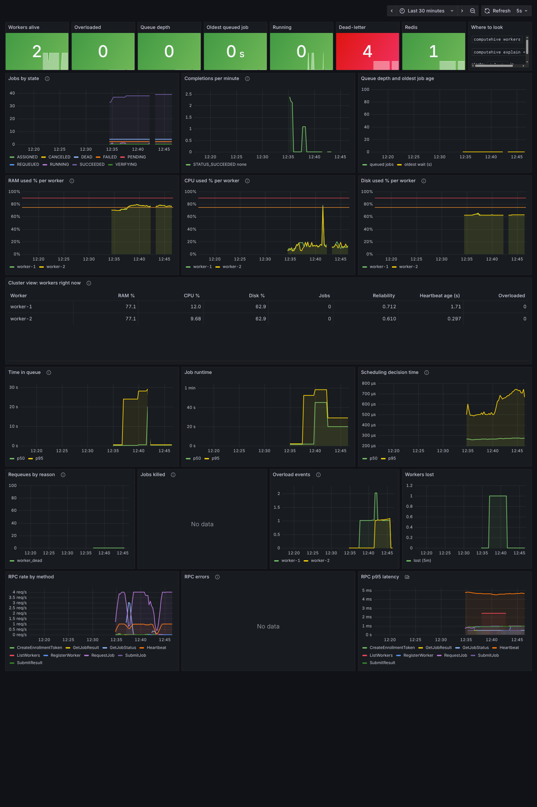

# Operating ComputeHive: metrics, alerts, logs, shutdown, runbook

Everything here is implemented and was exercised on the live Compose cluster; the places where it is approximate or unverified are
listed under [Limitations](#limitations).



*The provisioned dashboard on a running cluster (two workers). Rows: headline numbers, job flow, the 90% rule per worker, a one-row-per-worker
cluster view, latency histograms, failures, and the RPC layer.*

## What `make up` starts

| Service | URL | Notes |
|---|---|---|
| Coordinator | gRPC `:50051`, HTTPS `:8080` | `/healthz`, `/readyz`, `/metrics` (API token), artifacts, outputs |
| Prometheus | http://localhost:9090 | scrapes the coordinator over TLS with the API token; loads `deploy/prometheus/alerts.yml` |
| Grafana | http://localhost:3000 (admin / `GRAFANA_ADMIN_PASSWORD`, default `admin`) | dashboard **ComputeHive cluster** is provisioned; nothing to import |
| Redis | ephemeral loopback port | AOF on |

Prometheus keeps its data on a tmpfs (it must run as your user to read the private API token), so **metrics history is lost when the
Prometheus container restarts**. Use a real TSDB volume and a service account when you deploy beyond a laptop.

## Health and readiness

| Endpoint | Meaning |
|---|---|
| `GET /healthz` | the process is up (always 200 while it runs) |
| `GET /readyz` | 200 if Redis answers **and** the coordinator is not draining; 503 otherwise |

## Metrics

`GET /metrics` on the coordinator HTTP port, Prometheus text format, **requires the API token** (`Authorization: Bearer ...`) because it
lists worker ids and utilisation. Cluster gauges are read from Redis **at scrape time** (always the truth); event series are recorded as
events happen.

| Series | Type | Meaning |
|---|---|---|
| `computehive_jobs{state}` | gauge | jobs in each state (PENDING, ASSIGNED, RUNNING, SUCCEEDED, FAILED, REQUEUED, DEAD, CANCELED, VERIFYING) |
| `computehive_queue_depth` | gauge | jobs waiting for a worker |
| `computehive_oldest_pending_age_seconds` | gauge | age of the head of the queue: the "is it stuck" signal |
| `computehive_workers{state}` | gauge | workers `alive`, `dead`, `overloaded`, `paused` |
| `computehive_worker_ram_used_percent{worker}` `..._cpu_...` `..._disk_...` | gauge | per-worker utilisation (what the 90% rule acts on) |
| `computehive_worker_overloaded{worker}` | gauge | 1 while the worker is in the overloaded state |
| `computehive_worker_running_jobs{worker}` | gauge | jobs the worker holds |
| `computehive_worker_heartbeat_age_seconds{worker}` | gauge | heartbeat lag |
| `computehive_worker_reliability{worker}` | gauge | decayed success rate (0-1) used by the scheduler |
| `computehive_redis_up` | gauge | 1 if Redis answered the scrape |
| `computehive_jobs_submitted_total` | counter | accepted submissions |
| `computehive_job_completions_total{status,reason}` | counter | committed results; `reason` is `none` on success |
| `computehive_job_requeues_total{reason}` | counter | `worker_dead`, `lease_expired`, `infra`, `evicted` |
| `computehive_workers_lost_total` | counter | workers declared dead |
| `computehive_worker_overload_events_total{worker}` | counter | transitions into overload |
| `computehive_jobs_killed_total{kind}` | counter | `kill` = exit code 137/143, `evicted` = host overload |
| `computehive_job_time_in_queue_seconds` | histogram | submission to assignment |
| `computehive_job_runtime_seconds` | histogram | assignment to committed result |
| `computehive_scheduling_decision_seconds` | histogram | coordinator time to answer a worker's `RequestJob` |
| `computehive_scheduling_requests_total{outcome}` | counter | `assigned` or `none` |
| `computehive_grpc_requests_total{method,code}` | counter | every RPC |
| `computehive_grpc_request_duration_seconds{method}` | histogram | RPC handler latency |
| `go_*`, `process_*` | | runtime and process metrics |

## Alerts (`deploy/prometheus/alerts.yml`, validated with `promtool`)

| Alert | Fires when | First thing to do |
|---|---|---|
| `CoordinatorDown` (critical) | cannot scrape for 30 s | `docker compose ps`; coordinator logs; is the token/CA still mounted into Prometheus? |
| `RedisDown` (critical) | `computehive_redis_up == 0` for 15 s | Redis container and disk; no job can move until it is back |
| `NoLiveWorkers` (critical) | jobs queued, zero live workers, 1 min | start or enrol a worker; `computehive workers` |
| `WorkerLost` | a worker was declared dead in the last 2 min | worker host/logs; its jobs were requeued automatically |
| `WorkerHeartbeatLate` | heartbeat older than 10 s | network or a stalled worker |
| `WorkerRAMHigh` / `WorkerDiskHigh` | at or above 90% for 1 min | the 90% rule has tripped: the worker takes no jobs; find what else uses the host |
| `WorkerOverloadedLong` | overloaded for 10 min | as above; something is persistently using the machine |
| `QueueStuck` | oldest job older than 2 min for 2 min **while healthy workers exist** | almost always a job nobody can run: `computehive explain <job-id>` shows every worker's rejection reasons |
| `DeadLetterGrowing` | the DEAD count increased in 15 min | jobs exhausted their attempts; `computehive status <id>` |
| `HighRequeueRate` | more than 0.1 requeues per second for 2 min | workers failing or dying; break down by `reason` |
| `SchedulingSlow` | p95 decision time above 250 ms for 5 min | Redis latency, a very large pool, or a deep queue |

Exercised live: a worker killed with `docker kill` produced `job_requeues_total{reason="worker_dead"} 1`, `workers_lost_total 1` and the
`WorkerLost` alert in the firing state, and the dashboard showed both.

## Logs

Coordinator and worker write **one JSON object per line** to stdout (`LOG_FORMAT=text` on the worker for a terminal). Every worker line carries
`component` and `worker_id`; every coordinator RPC line carries a correlation id.

```json
{"time":"...","level":"INFO","msg":"rpc","component":"coordinator","request_id":"3f9a1c0e5b7d2a44","method":"SubmitResult","code":"OK","duration_ms":1.8,"job_id":"d294e200-...","worker_id":"worker-1"}
{"time":"...","level":"INFO","msg":"draining: no new jobs; finishing the current one","component":"worker","worker_id":"worker-1","event":"drain_started","job_id":"d294e200-..."}
```

- **Correlation:** a client may send an `x-request-id` header (letters, digits, `.`, `_`, `-`, up to 64 characters); anything else is replaced with a
  generated id, so a caller cannot inject log lines. The response always carries `x-request-id`, so a client error can be matched to a coordinator line.
- **Following one job:** `job_id` appears in the coordinator's RPC lines (submit, assign, result), its application lines (committed, requeued) and
  the worker's lines. `docker compose logs | jq -c 'select(.job_id=="<id>")'`.
- **Noise control:** `Heartbeat`, `ListWorkers` and `RequestJob` calls that find nothing are logged at debug level, so an idle cluster stays quiet.
- **Structured events** (`event` field) worth alerting on in a log pipeline: `intake_paused`, `drain_started`, `drain_timeout`, `drained`,
  `job_requeued_after_eviction`.

## Graceful shutdown

| Process | On SIGTERM / SIGINT | Bound |
|---|---|---|
| Coordinator | `/readyz` goes 503 immediately, it **keeps serving** for `SHUTDOWN_GRACE` (default 3 s) so probes and load balancers stop sending traffic, then closes the listeners and lets in-flight calls finish | in-flight gRPC calls: 15 s, then forced; HTTP: 10 s |
| Worker | stops asking for jobs, heartbeats `draining` (the coordinator stops assigning), lets the **current job finish**, then exits | `DRAIN_TIMEOUT` (default 30 s); after that the job is handed back as `evicted` (retried elsewhere, no attempt burned) |
| Worker, second signal | terminates immediately | |
| Worker kill switch (`computehive worker kill`) | stops everything at once and hands the job back | immediate |
| Compose | `stop_grace_period` is 30 s (coordinator) and 45 s (workers) so Docker does not SIGKILL a draining process | |

Measured on the live cluster: SIGTERM to the worker holding a 15 s job produced `drain_started`; the job finished on **attempt 1 of 3** (no requeue),
its result was published, and the worker logged `drained` and exited. SIGTERM to the coordinator gave `/readyz` 200, then 503 for about 3 s, then the
listener closed and the process exited with status 0.

A coordinator that is killed outright loses nothing: all state is in Redis, and on start the reaper recovers whatever was in flight.

## Runbook

| Symptom | Look at | Likely cause |
|---|---|---|
| "My job is still pending" | `computehive explain <job-id>` | no worker satisfies its requirements, or all are busy/overloaded; the output lists each worker's reasons |
| Jobs queued, workers idle | `QueueStuck` alert, `explain` | a constraint nobody meets (GPU, `--os`, `--arch`, `--label`, `--isolation`, `--min-disk`, network) |
| A worker shows `overloaded` | `computehive workers`, RAM/CPU/disk panels | host usage at or above 90%; the worker recovers 10 s after every metric is under 80% |
| A worker shows `dead` | `WorkerLost`, worker logs | process stopped or network cut; jobs were requeued within about 6 s |
| Jobs in the dead-letter set | `computehive status <id>`, the result's `failure_reason` | the job fails every attempt (bad image/command) |
| Metrics panel empty | Prometheus `/targets` | token or CA not mounted, coordinator down, or `https`/`server_name` mismatch |
| Everything slow | `scheduling decision time` and `RPC p95` panels | Redis latency or CPU starvation on the coordinator host |

## Limitations

- Per-worker series are capped at 200 workers (aggregate series still count all); beyond that, shard or aggregate.
- `computehive_jobs_killed_total{kind="kill"}` counts jobs that exited 137/143, which includes OOM, disk or PID quota kills **and** a manual `kill`;
  the worker does not yet report the specific sandbox reason as a separate failure reason, so it is an approximation.
- `worker_overload_events_total` detects transitions from heartbeats in coordinator memory; a coordinator restart can count one extra transition.
- No distributed tracing; correlation is by request id and job id in logs.
- The dashboard's table and panels were verified by rendering them in a browser against live data, but only with two workers.
- Prometheus data is not persisted in the Compose setup (see above), and alerts are evaluated but not routed anywhere (no Alertmanager is configured).
