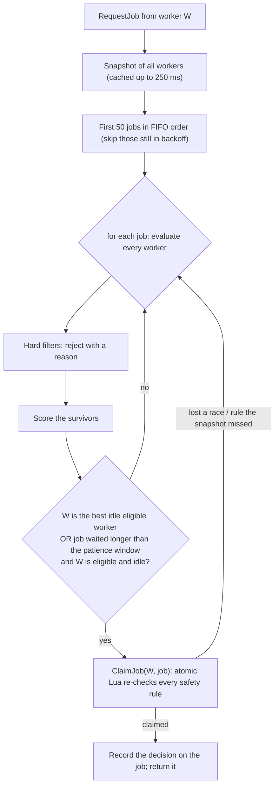

# Scheduling: how a job picks its worker

Code: `coordinator/internal/scheduler` (pure logic), `coordinator/internal/grpc/schedule.go` (glue and `ExplainJob`),
`coordinator/internal/queue` (`claim` Lua script, cluster snapshots). Tests: `scheduler_test.go` (table-driven filters and scoring),
`grpc/schedule_test.go` (a heterogeneous cluster on a real Redis).

## The shape of the decision

Workers **pull** jobs, so scheduling answers a narrow question each time a worker calls `RequestJob`:

> Of the jobs at the head of the queue, is there one this worker should run *now*, given everybody else?



Properties this buys:

- **FIFO is preserved** where it can be: jobs are considered in sequence order, and a worker takes the first job it is a good fit for.
  A job that no idle worker can run does not block the ones behind it.
- **Safety never depends on the snapshot.** The `claim` script re-checks overload, capacity, requirements, isolation, memory headroom
  and the per-user limit atomically. Stale data costs a worse placement, not a violated rule.
- **Cheap.** One pipelined Redis read for the whole cluster (shared by all pollers for up to 250 ms), one for the queue head, one atomic claim.
  The scheduler itself is pure CPU: measured on an i7-13620H, **5.2 µs** per job against 10 workers, **60 µs** against 100, **0.77 ms**
  against 1000 (`go test -bench Evaluate ./internal/scheduler`). A request evaluates at most 50 jobs, so the pure-CPU worst case
  at 1000 workers is on the order of tens of milliseconds; end-to-end latency with Redis is measured in the benchmarks phase.

## Hard filters (a worker failing any is ineligible, and `explain` says why)

| Filter | Rule |
|---|---|
| Liveness | heartbeat within the dead-after window (6 s) |
| Not paused | the contributor has not paused or drained the worker |
| **90% rule** | not overloaded (the coordinator derives this from raw metrics; it does not take the worker's word) |
| Metrics present | a worker that reports no usage gets no work |
| Verification | the second replica of a `--verify` job never runs on the worker that ran the first |
| CPU / RAM / GPU | job request does not exceed what the worker offers |
| Disk | free disk at least `--min-disk` |
| Platform | `--os` / `--arch` match |
| Isolation | `--isolation gvisor` needs a gVisor worker |
| Network | a job that needs network hosts only goes to a contributor who allows network jobs |
| Labels | the worker carries every `--label` the job requires |
| Memory headroom | current use + memory already promised to running jobs + this job stays under the limit |
| Reliability | not blacklisted (see below) |
| Fairness | the job's user is under `USER_LIMIT` running jobs |

## The score

Each component is normalised to 0..1 and multiplied by its weight; the weights sum to 1, so a total is in 0..1.

| Component | Weight | Meaning |
|---|---|---|
| `free_ram` | 0.22 | RAM left after placing the job (spreads load, avoids hot-spotting) |
| `reliability` | 0.20 | decayed success rate of recent jobs |
| `free_cpu` | 0.14 | CPU currently idle |
| `load` | 0.14 | 1-minute load average per core |
| `locality` | 0.10 | the job's artifact is already cached on the worker (no download) |
| `fit` | 0.10 | job size relative to the worker: small jobs prefer small workers, keeping big ones free (anti-fragmentation) |
| `uptime` | 0.05 | time as a stable member (full marks at 24 h) |
| `preference` | 0.05 | the contributor's own willingness (`WORKER_PREFERENCE`, 0-100) |

Ties break on worker id, and the components are summed in a fixed order, so the same inputs always give the same decision (a test
caught float-addition order making identical workers differ in the last bit).

### Reliability and blacklisting

Each completion or counted infrastructure failure updates a per-worker record that decays with a **1-hour half-life**, so an old failure fades.
The score is `(ok + 2) / (ok + fail + 4)`: a brand-new worker starts at 0.5, not 0 or 1. A worker is blacklisted only when its decayed
reliability is below 0.2 *and* it has at least 5 recent samples, so one bad job cannot exile a worker.

### Locality

Workers keep verified artifacts in a size-bounded LRU cache (`ARTIFACT_CACHE_MB`, default 2048) and report the digests with each
heartbeat. An identical artifact scores full locality on the worker that holds it, and the worker skips the download (measured on the
live cluster: bundle ready in 4 ms from cache). Because Docker stamps build time into images, the CLI caches the saved image per job
directory so that re-submitting an unchanged directory yields the *same* artifact.

## Patience (no starvation)

A job is normally held for its best-fit idle worker. If that worker never asks (busy, slow polling, gone quiet), the job would wait
forever. After `SCHED_PATIENCE` (default 5 s) **any eligible idle worker** that asks may take it. Patience relaxes the *preference*,
never a filter: an overloaded worker is never given a job, however long it has waited (tested).

## Explaining a decision

`computehive explain <job-id>` prints every worker with its verdict. For a placed job it shows the decision recorded at assignment time
(the scores that were true then); for a waiting job it evaluates the live cluster, so "why is my job still pending?" has an answer.

```
job 0e51aec3-... (succeeded)
decision recorded when the job was assigned
  worker-1 scored highest (0.600); its strongest component was reliability

  * worker-1: score 0.600
      free_ram     0.066  (weight 0.22)
      locality     0.100  (weight 0.10)
      reliability  0.150  (weight 0.20)
      ...
    worker-2: score 0.436
      locality     0.000  (weight 0.10)
```

## Configuration

| Setting | Default | Effect |
|---|---|---|
| `SCHED_PATIENCE` | 5 s | how long a job waits for its best-fit worker |
| `SCHED_SNAPSHOT_TTL` | 250 ms | maximum age of the worker view used for placement |
| `USER_LIMIT` | 0 (off) | max running jobs per user |
| `RAM_LIMIT_PERCENT` | 90 | memory headroom limit used by the filter |
| worker `WORKER_LABELS`, `WORKER_PREFERENCE`, `WORKER_OS`, `WORKER_ARCH`, `ARTIFACT_CACHE_MB` | | what a worker announces |

Job requirements come from flags (`--cpu --mem --gpu --min-disk --os --arch --label --isolation --network-host`), from `computehive.yaml`
in the job directory (flat `key: value`), or from `LABEL computehive.<key>=...` lines in the Dockerfile. Flags beat the manifest,
which beats Dockerfile labels. Unknown manifest keys are an error, so a typo cannot silently run a job with the wrong resources.

## Known limitations

- **Rich get richer.** A worker with a longer successful history and a warm cache scores higher and so wins ties, which gives it more
  history. The weights keep this soft (a heavily loaded favourite still loses to an idle newcomer), but the effect is visible in
  `workers` (reliability 0.88 vs 0.50 after a few jobs).
- **Greedy, not optimal.** Placement is per request, in queue order; there is no global assignment solve, no preemption, and no gang scheduling.
- **Snapshot staleness.** Up to 250 ms; two simultaneous requests can both pick the same "best" worker, in which case the second
  `ClaimJob` fails safely and the job goes to the next candidate.
- **Weights are hand-set**, not learned. They are exposed in `explain` so they can be tuned against evidence.
- **Fairness is a cap**, not weighted fair queuing: `USER_LIMIT` stops one user monopolising the cluster but does not interleave users proportionally.
